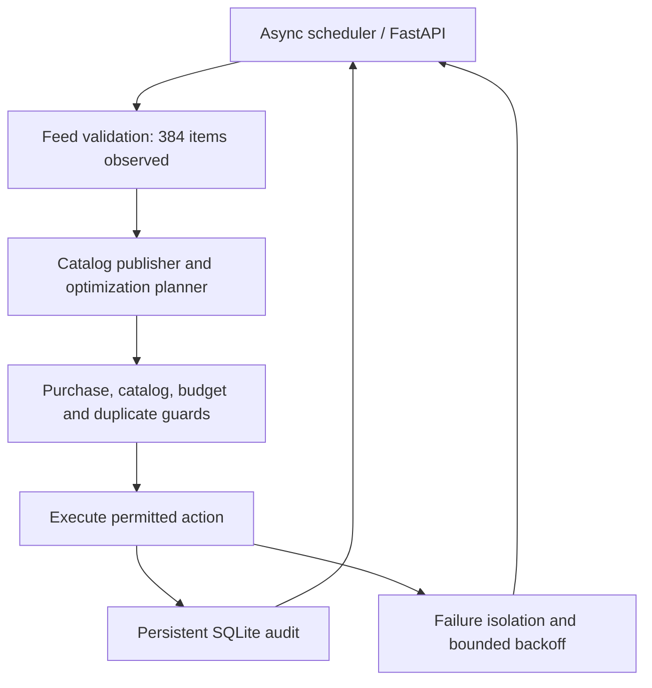

# Homestro Pilot: 24/7 operational architecture

## Deployment scope — 24 October 2026

Existing Railway service: homestro-adtech-pilot, production. Source branch: deploy/adtech-pilot. Preserve the existing service, persistent /data volume, Shopify integration and deployment configuration. PR #115 is merged. This document does not declare the entire requested discovery/SEO/marketplace system complete.

## Existing runtime

The existing async scheduler isolates provider failures and uses timeouts, exponential backoff and jitter for failures. Railway restarts the service on exit. Local audit and the single-campaign claim survive restarts through the existing persistent volume when PILOT_AUDIT_DB_PATH points into /data. This is a rule-based operational scheduler and planner, not proof of a complete self-improving LLM agent. Healthy startup alone is not proof of campaign delivery, publication or sales.

## Critical campaign retirement

Target only campaign 120254321479480274. Run reconciliation before the paid publisher gates, so missing Purchase verification cannot prevent maintenance. Read the parent state; an active or uncertain parent retains its claim. If the parent is PAUSED, inspect all returned child adsets. Incomplete pagination or malformed IDs block retirement. Idempotently set ACTIVE child adsets to PAUSED, then reread parent and child states. Only confirmed inactivity permits local retirement.

A single SQLite transaction removes the exact matching single-campaign claim and inserts meta_campaign_archived into adtech_audit with status INACTIVE and the prior status. No historical spend or prior audit records are deleted. This reuses the existing initialized schema and needs no destructive schema migration. The heartbeat reports retired_campaign separately from the new publisher result. A failed remote pause or DB transaction never counts as completed retirement.

## Catalog publisher

The publisher takes META_PRODUCT_CATALOG_ID and optionally META_PRODUCT_SET_ID. Without an explicit set ID it selects a unique existing All Products / Alle Produkte set; ambiguous or incomplete lookup blocks publication. Catalog creative uses catalog media and destinations, eliminating the one-product MICRO_BUDGET_PRODUCT_ID submission restriction and paid AI image generation in this path. Feed item count is not independent proof of product-set membership or approved Meta items.

Live creation remains gated by META_PURCHASE_EVENT_VERIFIED, billing readiness, account checks, the configured daily ceiling, and the persistent one-campaign guard. Preserve the owner's DE/AT targeting, EUR5 daily / EUR35 seven-day ceiling and prohibition on spending before verified Purchase measurement. Never set the verification flag merely to unblock a run. Do not generate duplicate products or paid creative assets.

## Verified limitations

The production heartbeat reports NO_VERIFIED_CHANNEL_METRICS_LOADER: the optimization path remains READ_ONLY. A real performance loader, trustworthy purchase attribution and contribution-margin evidence are still needed for autonomous kill/scale. Pixel access does not prove Purchase measurement. Meta Ad Library discovery separately reports missing access-token configuration; this does not invalidate the working Meta Ads connection. Merchant diagnostics have their own missing configuration. Do not reconfigure working connections because an unrelated module is blocked.

The complete discovery, GEO/SEO, inventory/order-sync and Higgsfield-to-social-queue pipeline is not established by PR #115. Any future creative ingestion must prove that the pilot accepted the existing asset, persisted a unique queue item and scheduled it; actual publication additionally requires a returned platform ID/link. No such handoff is claimed here.

## Validation

48 Python tests passed locally, including retirement without Purchase, preservation of an active parent claim, and child pause/readback before archive. Ruff checks passed and mypy passed across 20 source files. Production retirement must be confirmed from a new heartbeat, separately from successful build/health checks.
